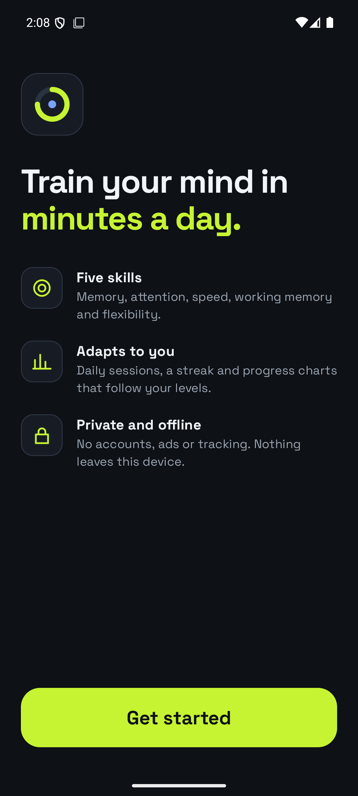
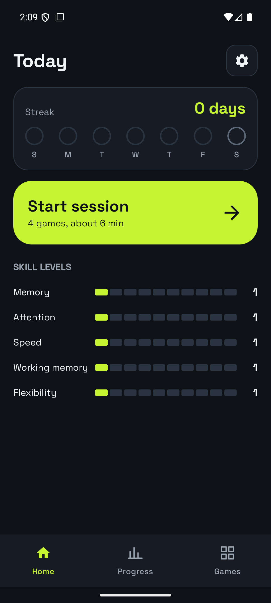
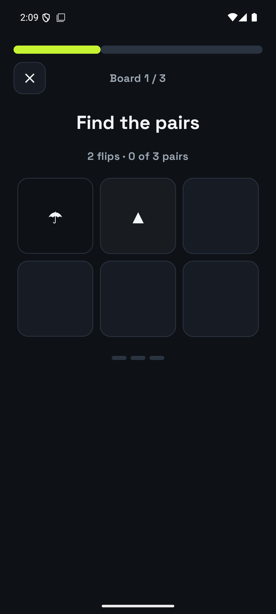
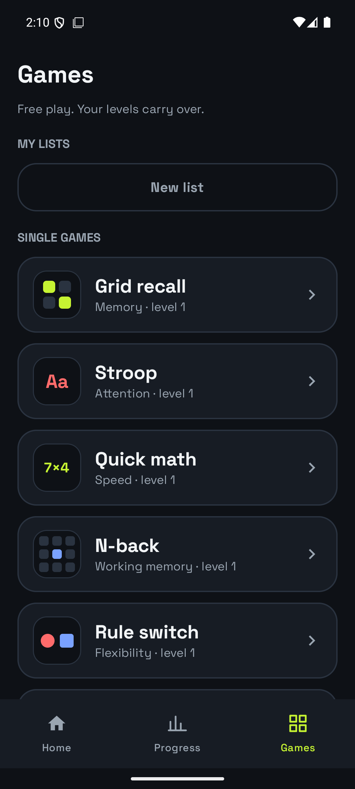
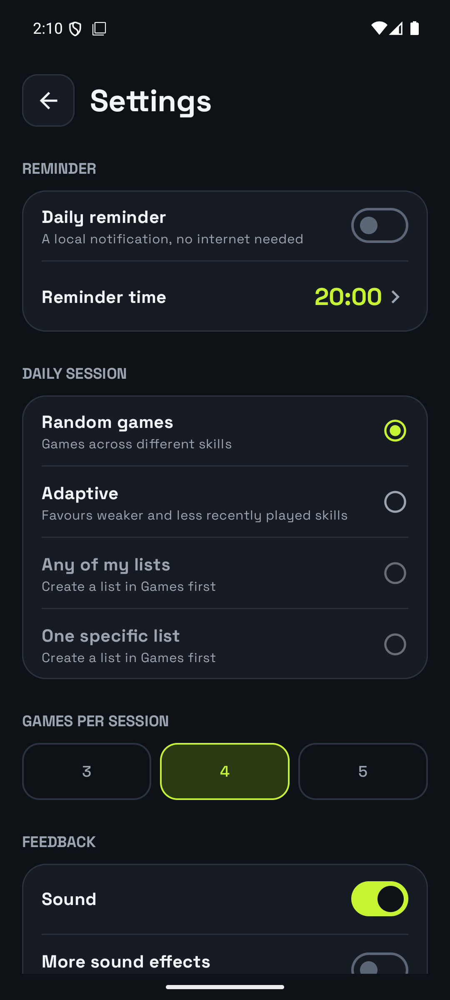

# Trainer

Native Android (Kotlin, Jetpack Compose) brain-training app. Fully offline: the manifest does not
declare `INTERNET`. Everything builds inside Docker; nothing but Docker is needed on the host.

## Features

13 short mini-games across five skills (memory, attention, speed, working memory, flexibility), daily sessions
with per-skill adaptive difficulty, custom game lists, streak, progress charts and insights, an optional local
reminder, dark, light and colour-blind themes, backup export and import, and English and Spanish. See
`CHANGELOG.md` for the full list.

## Screenshots

<p>
  
  
  
  
  
</p>

## Commands

```bash
docker compose build
docker compose run --rm dev ./gradlew :core-game:test testDebugUnitTest lint
docker compose run --rm dev ./gradlew assembleDebug installDebug
docker compose run --rm dev ./gradlew bundleRelease assembleRelease   # needs signing, see below
```

The `Makefile` wraps these: `make help` lists the shortcuts (`check`, `test`, `lint`, `debug`, `install`,
`release`, `adb-devices`, `clean`, `shell`, `image`). CI runs the same targets with `RUN=` (no Docker wrapper).

## App parameters

The name and id are build parameters; the defaults are neutral. Precedence: `-P` Gradle property,
then environment variable, then the tracked `app.properties`, then the default.

| Parameter | `app.properties` | Default |
|---|---|---|
| `APP_NAME` | `Tempo` | `Trainer` |
| `APP_ID` | `io.github.desvelao.tempo` | `app.example.trainer` |
| `APP_URL` | `https://github.com/desvelao/tempo` (shown in Settings > About) | `https://example.com` |
| `APP_VERSION_NAME` / `APP_VERSION_CODE` | not set (release workflow) | `0.1.0` / `1` |

```bash
APP_NAME="My App" APP_ID=com.example.myapp docker compose run --rm dev ./gradlew assembleDebug
```

## Release signing

Create a keystore inside the container (kept out of git) and `keystore.properties`:

```bash
docker compose run --rm dev bash -c '
  PW=$(head -c 24 /dev/urandom | base64 | tr -dc A-Za-z0-9 | head -c 24)
  keytool -genkeypair -keystore release.jks -alias release -keyalg RSA -keysize 4096 -validity 10000 \
    -dname "CN=Release" -storepass "$PW" -keypass "$PW"
  printf "storeFile=release.jks\nstorePassword=%s\nkeyAlias=release\nkeyPassword=%s\n" "$PW" "$PW" > keystore.properties'
```

Or pass `SIGNING_KEYSTORE`, `SIGNING_STORE_PASSWORD`, `SIGNING_KEY_ALIAS`, `SIGNING_KEY_PASSWORD` as
environment variables. A release build without signing details fails on purpose. Back up the keystore:
losing it means you cannot update an installed app.

Outputs: `app/build/outputs/bundle/release/app-release.aab`, `app/build/outputs/apk/release/app-release.apk`,
and the R8 mapping in `app/build/outputs/mapping/release/mapping.txt`.

## Releases

`.github/workflows/release.yml` tests, signs and builds the app on GitHub and publishes a GitHub Release.

1. Add repository secrets: `SIGNING_KEYSTORE_BASE64` (`base64 -w0 release.jks`), `SIGNING_STORE_PASSWORD`,
   `SIGNING_KEY_ALIAS`, `SIGNING_KEY_PASSWORD`.
2. Move the `Unreleased` entries in `CHANGELOG.md` under a new `## [x.y.z] - date` heading (a pre-release such
   as `1.2.3-rc.1` can use its own heading or the `1.2.3` one).
3. Tag and push: `git tag v1.2.3 && git push origin v1.2.3`. Pre-release tags (`v1.2.3-rc.1`, `-beta.N`,
   `-alpha.N`) create a GitHub pre-release.

Versions: release tags use `versionCode = major*10000 + minor*100 + patch` and `versionName` `1.2.3+<sha>`.
Because an rc/beta/alpha and its final share a code, Android will not update one to the other; uninstall first.
Other runs (manual `workflow_dispatch`) use `github.run_number` as code and `<version>-dev+<sha>` as name, and
only upload the files as a workflow artifact.

## Download and verify

Releases are published on the repository's Releases page (the link is in Settings > About). Each release has the
APK (to install), the AAB, the R8 mapping file and a `SHA256SUMS` file with the SHA-256 of all of them.

```bash
# Download the APK and the checksums (browser, or the GitHub CLI):
gh release download v0.1.0 --repo <owner>/<repo> --pattern '*.apk' --pattern SHA256SUMS

# 1. Check the file was not corrupted or replaced:
sha256sum --check --ignore-missing SHA256SUMS      # prints "<file>.apk: OK"

# 2. Check who signed it (apksigner is in the Android SDK build-tools, or `docker compose run --rm dev`):
apksigner verify --print-certs <file>.apk | grep 'SHA-256 digest'
```

The release signing certificate's SHA-256 is
`39ab4d9a15cf306074cc15d65b2b382699ef63cdacc5906ccf3a0130b9f73b43`; the digest printed in step 2 must match it.
Step 1 only proves the APK matches `SHA256SUMS` from the same release, so an attacker who can replace release
files can replace both; step 2 is what proves the APK was signed with the project's key. Android also refuses to
update an installed app with an APK signed by a different key. Uninstall a debug build before installing a release
build, because their signatures differ.

## Design

The UI follows the "Focus" direction: near-black surfaces, one lime accent, a blue highlight and large
numerals, set in Space Grotesk. The font file (`app/src/main/res/font/space_grotesk.ttf`) is bundled so the
app stays offline; its licence (SIL Open Font License 1.1) is in `fonts-license/`. Colours and type live in
`app/src/main/kotlin/app/trainer/ui/theme/Theme.kt`. The theme setting defaults to Dark.

## License

MIT, see `LICENSE`. The bundled font keeps its own licence in `fonts-license/`.
